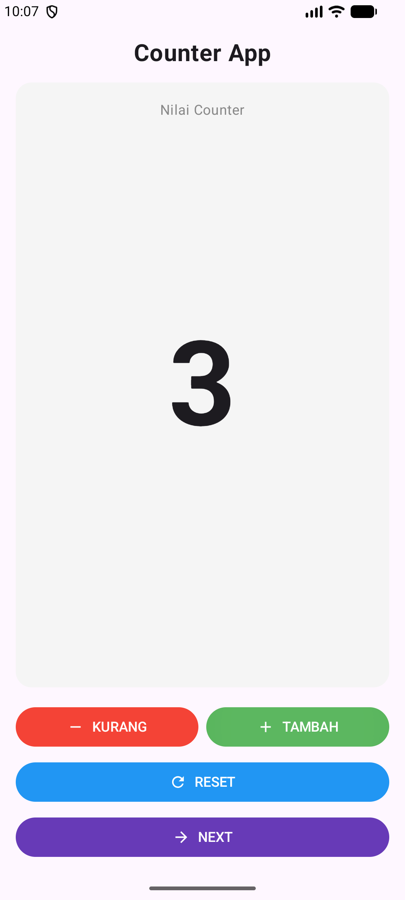
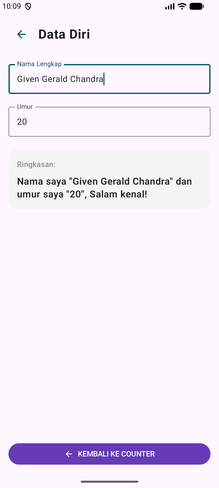

# ComposeCounterGiven

Proyek praktikum Pemrograman Perangkat Bergerak (Pertemuan 11) berbasis **Jetpack Compose** dengan studi kasus Counter App dan Challenge Data Diri Screen.

## Identitas Mahasiswa
- **Nama:** Given Gerald Chandra
- **NIM:** 560235
- **Mata Kuliah:** Praktikum Pemrograman Perangkat Bergerak (PPPBD)
- **Topik:** Layout Row, Column, Box, State, ViewModel, dan SharedPreferences dengan UI Jetpack Compose

---

## Fitur & Implementasi

### 1. Codelab 1 – Layout Row, Column, dan Box
- Menggunakan `Column` sebagai wadah vertikal utama layar.
- Menggunakan `Box` bersudut membulat (`RoundedCornerShape(16.dp)`) untuk menumpuk label "Nilai Counter" dan angka counter secara terpusat.
- Menggunakan `Row` untuk menata tombol aksi **KURANG** dan **TAMBAH** berdampingan secara horizontal dengan pembagian proporsi yang seimbang (`weight(1f)`).
- Menambahkan tombol **RESET** berlebar penuh (`fillMaxWidth()`).
- Menggunakan vector drawable: `ic_remove.xml`, `ic_add.xml`, dan `ic_refresh.xml`.

### 2. Codelab 2 – Implementasi State
- Menggunakan `rememberSaveable` dan `mutableIntStateOf(0)` agar nilai counter bertahan saat terjadi rotasi layar (*configuration change*).
- Menghubungkan event klik tombol **KURANG** (`counter--`), **TAMBAH** (`counter++`), dan **RESET** (`counter = 0`) dengan pembaruan state secara reaktif (*recomposition*).

### 3. Codelab 3 – ViewModel & SharedPreferences (UDF Architecture)
- Memisahkan logika aplikasi ke dalam `CounterViewModel` yang diturunkan dari `AndroidViewModel`.
- Mengintegrasikan penyimpanan lokal `SharedPreferences` (`counter_prefs.xml`) agar nilai counter tetap tersimpan permanen bahkan ketika aplikasi ditutup dari recent apps maupun gawai di-*restart*.
- Menerapkan pola *State Hoisting* pada `CounterApp` dan `CounterScreen` sehingga UI bersifat *stateless* dan mudah diuji.

### 4. Challenge Assignment
- Menambahkan tombol **NEXT** dengan ikon panah di bawah tombol **RESET** pada `CounterScreen`.
- Navigasi layar mulus dari `CounterScreen` ke `DataDiriScreen` serta penanganan tombol kembali (*back navigation*).
- Pada `DataDiriScreen`:
  - Form input nama (`OutlinedTextField`).
  - Form input umur (`OutlinedTextField` dengan `KeyboardType.Number`).
  - Ringkasan hasil inputan secara dinamis di bawah form dengan format tepat:
    ```
    Nama saya "$nama" dan umur saya "$umur", Salam kenal!
    ```
  - Dikelola dengan `DataDiriViewModel` dan persistensi `SharedPreferences` agar data diri tidak hilang saat navigasi maupun rotasi layar.

---

## Tangkapan Layar (Screenshots)

| Layar Utama (Counter Screen) | Layar Challenge (Data Diri Screen) |
| :---: | :---: |
|  |  |

---

## Riwayat Komit Git Bertahap

```text
6724f19 feat(challenge): implementasi DataDiriScreen dengan ViewModel dan navigasi tombol Next
fd3e02f feat(codelab3): implementasi CounterViewModel dengan persistensi SharedPreferences dan UDF
8a69e31 feat(codelab2): implementasi state counter menggunakan remember dan rememberSaveable
d8842aa feat(codelab1): implementasi layout CounterScreen dengan Column, Row, dan Box
bcb7f11 chore: initial project setup for ComposeCounterGiven
```
